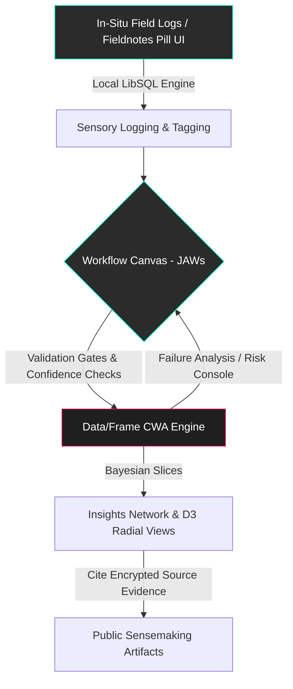

# 🔍 inspect

**The local-first Next.js engine for Joint Activity Workflows (JAWs), sensory field logging, and Bayesian systemic insight mapping.**

`inspect` is Datagotchi Labs' flagship sensemaking platform. It bridges qualitative human friction with executable structural models—allowing operators and stewards to capture in-situ observations, build directed **Joint Activity Workflows (JAWs)**, trace root causes across complex systems, and audit evidence-backed claims without black-box token waste.

---

## 🚀 Dual Core Architecture & Integrated Primitives

`inspect` operates across three tightly coupled sensemaking primitives:

### 📝 1. Fieldnotes (Sensory Research & Observational Primitive)
*Originally an independent observational logger, now fully integrated into the `inspect` platform.*
- **In-Situ Observational Capture:** Enables stewards operating in complex, high-stakes environments (Education, Healthcare, Community Organizing) to capture high-integrity, structured observations without relying on extractive cloud architectures.
- **Pill UI & Ergonomics:** Custom visual-salience components reduce cognitive overhead during real-time event logging.
- **LibSQL / SQLite Engine:** Local-first data architecture guarantees near-zero latency, total offline independence, and deterministic state transitions.

### ⚡ 2. JAWs & Collaborative Copilot (Orchestration & Validation Primitive)
*Translates Human-in-the-Loop orchestration and supervisory control into node-scoped operational flows.*
- **Cognitive Work Analysis (CWA) & Joint Activity Design:** Maps human operators, system nodes, biological/sensory friction points, and processing engines into directed acyclic graphs (DAGs).
- **Validation Gates & Risk Console:** Enforces explicit confidence checks, schema validations, and unit tests prior to human review, keeping human agency firmly at the center.
- **Friction-to-Artifact Pipeline:** Traces raw inputs (*e.g., Sensory & Information Overload*) through sensemaking engines down to concrete public artifacts (*e.g., zines, reports, local ledgers*).

### 🕸️ 3. My Insights (Causal & Radial Networks)
*Structures subjective claims, Bayesian belief dependencies, and empirical evidence.*
- **Bayesian Causal Slices ($a \rightarrow b$):** Isolates specific root-cause sub-graphs to prevent cognitive overload.
- **D3 Radial Graph Views:** Interactive radial and hierarchical layouts for exploring multi-variable system dependencies and trade-off surfaces.
- **Evidence Lineage:** Anchors every node and claim directly to verifiable point-of-origin fieldnotes and source data.

---

## 🎯 The Friction & The Solution

Modern teams suffer from **cognitive fragmentation**, **unvalidated black-box automation**, and **opaque system logic**:
- **Opaque Automation:** AI tools invent connections rather than exposing audited causal logic.
- **Context Overload & Burnout:** High-velocity feeds bombard operators, leading to burnout and executive exhaustion.
- **Locked Data Commons:** Graph intelligence is routinely gated behind proprietary cloud platforms.

**`inspect` solves this by:**
1. Logging raw field observations directly via offline-first **Fieldnotes**.
2. Converting operational friction into explicit, human-validated **Joint Activity Workflows (JAWs)**.
3. Rendering localized **Bayesian network slices** so teams focus only on task-relevant causal dependencies.
4. Maintaining **local-first, cryptographic data sovereignty** across dual database architectures (SQLite for local execution, Postgres for production sync).

---

## 🏗️ System Data Flow

---

## 🔐 Privacy, Security & Governance Roadmap

We are architecting `inspect` for high-integrity field environments:
- **Zero-Trust Local Storage:** Local-first storage ensuring total offline independence and user data ownership.
- **End-to-End Encryption (E2EE):** Encrypted synchronization for field logs and model metadata.
- **Biometric Guarding & WebAuthn:** FaceID / TouchID session guarding for secure local sessions.
- **Hardware Sovereignty:** FIDO2 / Yubikey physical security key support to verify steward identity.

---

## 🛠️ Tech Stack

- **Framework:** Next.js 16 (App Router, Turbopack)
- **Database / ORM:** SQLite / LibSQL via `better-sqlite3`, Knex, and Objection.js
- **Styling & UI:** Bootstrap, Custom CSS modules
- **Visualizations:** D3.js (Radial graphs), Mermaid.js (DAGs)